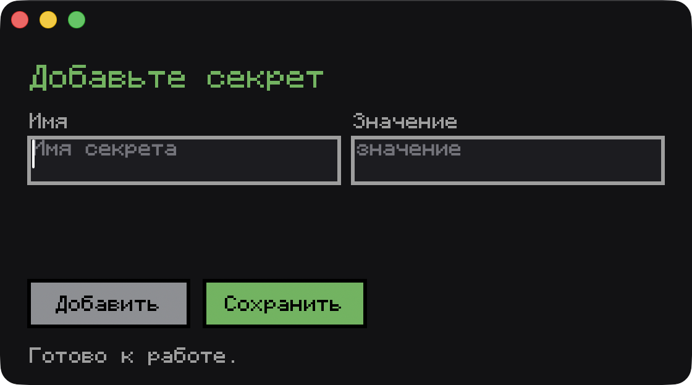

# Секреты

Небольшое приложение для macOS. Несколько секретов за раз записываются в Связку ключей, сами значения на экран не выводятся.



## Что умеет

- В каждой строке два поля: имя (`JIRA_TOKEN`) и значение.
- **Добавить** создаёт ещё одну строку. Если строк больше одной, лишнюю можно убрать кнопкой `x`.
- **Сохранить** запускает `save-secrets.sh`. Скрипт кладёт значения в Связку ключей (service `cursor-secret`, account совпадает с именем) и дописывает имена в `~/.config/cursor-secrets/names`. Значения в этот файл и в статус не попадают.
- ⌘V вставляет текст из буфера в активное поле. Переводы строк убираются, поэтому токен из менеджера паролей ложится одной строкой.

## Требования

macOS 14 или новее, Apple Silicon и Intel. Для сборки нужны Command Line Tools (`swiftc`).

## Сборка

```bash
./build.sh
open SecretPad.app
```

При первом сохранении macOS может спросить доступ к Связке ключей. Выберите «Всегда разрешать».
